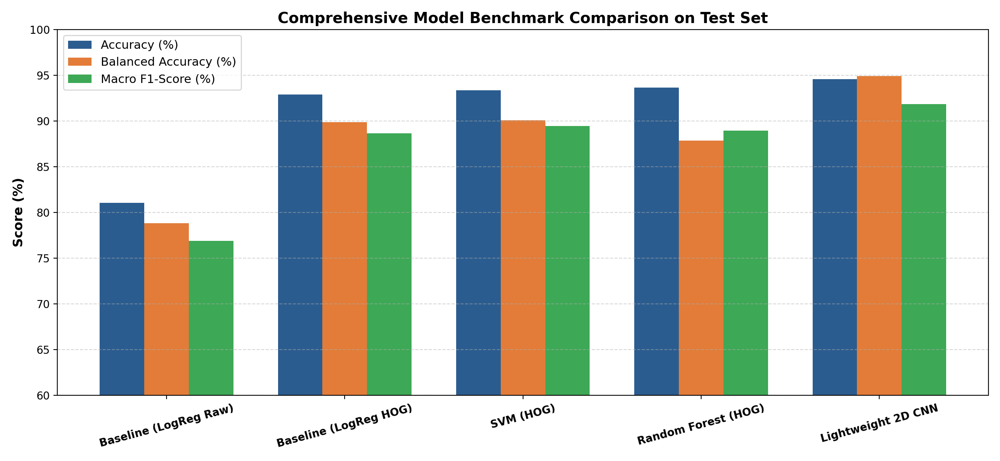
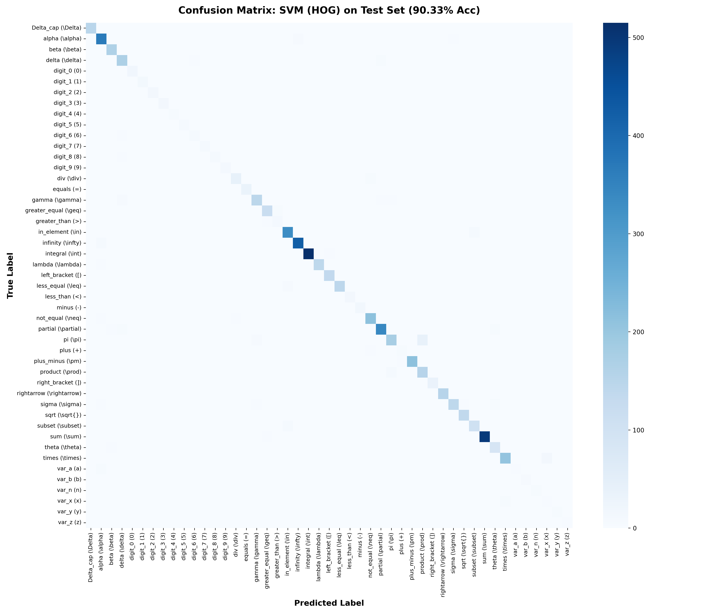
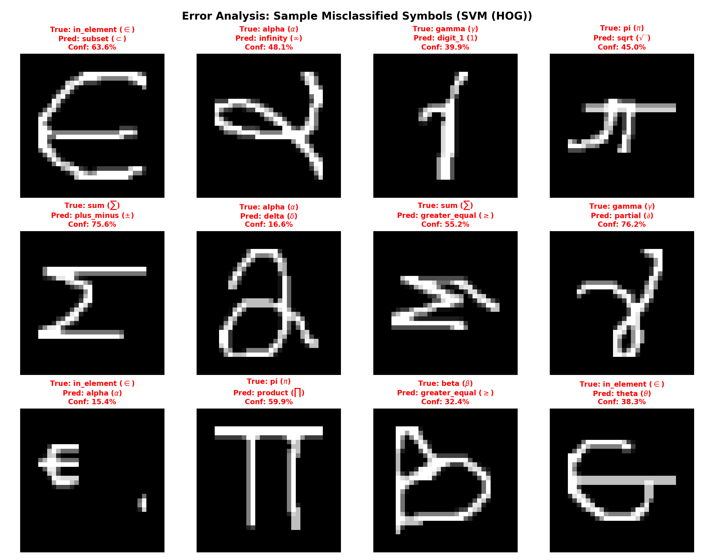
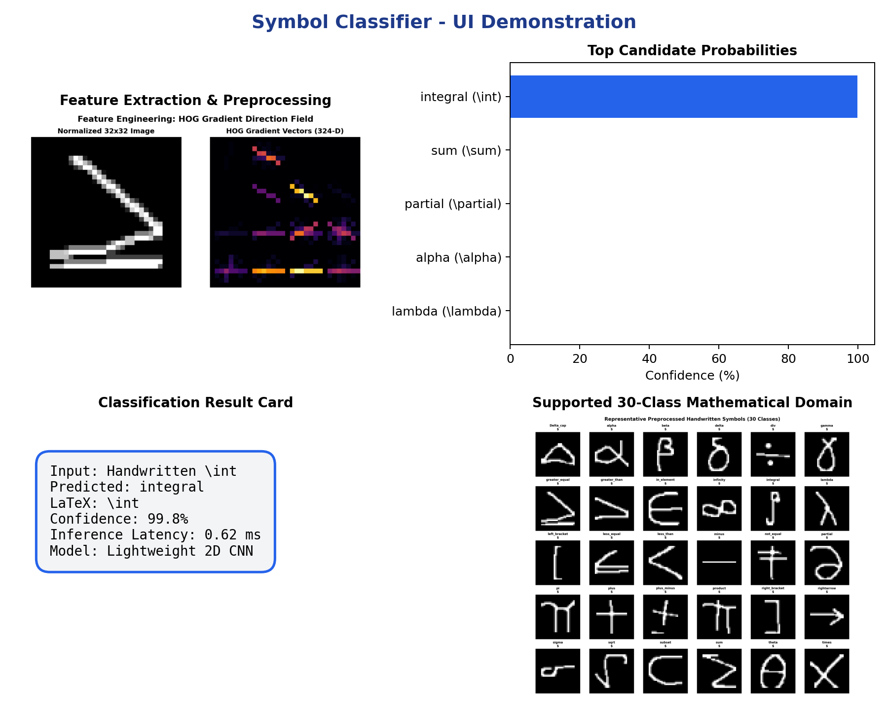
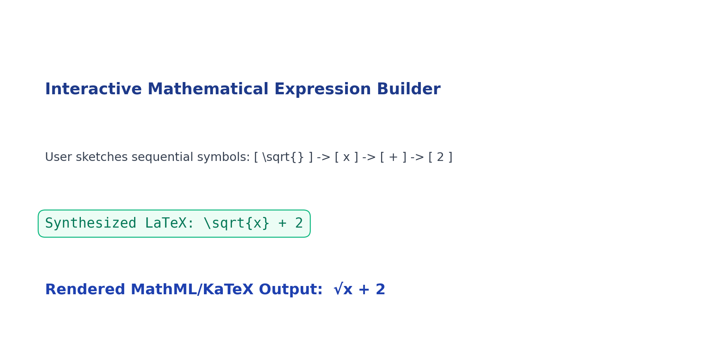

# Handwritten Symbol Classifier – Intelligent Recognition of Mathematical and Special Symbols

> **B.Tech CSE 5th-Semester Machine Learning Innovative Assignment**  
> An end-to-end, reproducible, and explainable Machine Learning solution for recognizing handwritten mathematical and scientific notations.

---

## 📌 Problem
Digitizing handwritten mathematical expressions remains one of the most persistent bottlenecks in automated document processing and STEM education. While conventional Optical Character Recognition (OCR) systems such as Tesseract perform reliably on printed, linear typography, they break down when applied to handwritten mathematics. Mathematical handwriting contains multi-scale symbols, intricate curvature, non-standard orientations, disconnected strokes, and severe geometric overlap (e.g., distinguishing `$+$` from `$\times$`, `$\le$` from `$<$`, or `$[` from `$\{$`).

This project solves the foundational task in mathematical OCR: **highly accurate, explainable, and real-time classification of isolated handwritten mathematical and special symbols**, bridging the gap between raw student sketches and machine-readable digital notation (LaTeX / MathML).

---

## 💡 Motivation
Standard university ML assignments often default to the MNIST digit dataset. However:
1. MNIST is an over-saturated, 10-class toy problem ($0–9$) that does not reflect real-world handwriting ambiguity.
2. In actual STEM education, university students write complex equations featuring integrals, summations, radicals, relational operators, and Greek variables.
3. Building a mathematical symbol classifier requires addressing **genuine class imbalance**, **spatial stroke centering**, **geometric feature engineering (HOG)**, **multi-class decision boundaries**, and **model explainability**.

---

## 🚀 Innovation: "Handwritten Expression → Microsoft Word Equation Suite"
Rather than serving solely as an isolated classification model, this project implements a full **Mathematical Expression Recognizer & Microsoft Word Equation Suite**:
1. **Big Interactive Whiteboard Canvas:** A wide $980 \times 280$ px canvas allows users to write entire multi-symbol equations from left to right (e.g., $2x + 3 = 5$, $\sqrt{x} + 2$, $\int x$, $\alpha + \beta = \pi$).
2. **Automatic Stroke Segmentation & Multi-Glyph Recognition:** Click **"✨ Recognize Drawing"** and the system automatically segments strokes, merges composite glyphs ($=$, $\div$, $\pm$, $i$), crops, centers, classifies each character, and orders them from left to right.
3. **Microsoft Word Equation Environment:** Styled like Microsoft Word's Equation Editor (`Alt` + `=`), featuring a rendered KaTeX formula container, live editable text input bar, and a Word-style template ribbon (fractions $\frac{a}{b}$, exponents $x^2$, subscripts $x_i$, radicals $\sqrt{x}$, integrals $\int$, summations $\sum$).
4. **1-Click 3-Way Export for Microsoft Word:**
   - **For MS Word (LaTeX Mode):** Paste into Word via `Alt` + `=` and press Enter.
   - **For MS Word (Native MathML XML):** Direct clipboard paste into Word, PowerPoint, or OneNote natively renders an editable 2D equation.
   - **Plain Text Formula:** Clean plain-text equation string for assignments or code comments.

---

## 📦 Dataset: HASYv2 (HAtala SYmbols v2)
- **Primary Source:** Martin Thoma, Karlsruhe Institute of Technology (KIT), 2017.
- **Archive DOI:** [10.5281/zenodo.259444](https://zenodo.org/records/259444) / arXiv: [1701.08380](https://arxiv.org/abs/1701.08380).
- **License:** **Creative Commons CC0 1.0 Universal (Public Domain Dedication)** — free for academic and educational usage.
- **Full Scope:** 168,233 instances across 369 classes.
- **Curated Academic Subset:** **47 classes** totaling **39,927 samples** ($32 \times 32$ pixels):

| Category | Symbols Included | LaTeX Representation |
| :--- | :--- | :--- |
| **Arabic Digits** | $0, 1, 2, 3, 4, 5, 6, 7, 8, 9$ | `0`, `1`, `2`, `3`, `4`, `5`, `6`, `7`, `8`, `9` |
| **Algebraic Variables** | $x, y, z, a, b, n$ | `x`, `y`, `z`, `a`, `b`, `n` |
| **Arithmetic Operators** | $+$, $-$, $\times$, $\div$, $\pm$, $=$ | `+`, `-`, `\times`, `\div`, `\pm`, `=` |
| **Relational Operators** | $<$, $>$, $\le$, $\ge$, $\ne$ | `<`, `>`, `\leq`, `\geq`, `\neq` |
| **Calculus & Analysis** | $\sqrt{}$, $\int$, $\sum$, $\prod$, $\infty$, $\partial$ | `\sqrt{}`, `\int`, `\sum`, `\prod`, `\infty`, `\partial` |
| **Greek Mathematical Letters** | $\alpha$, $\beta$, $\gamma$, $\delta$, $\Delta$, $\pi$, $\theta$, $\lambda$, $\sigma$ | `\alpha`, `\beta`, `\gamma`, `\delta`, `\Delta`, `\pi`, `\theta`, `\lambda`, `\sigma` |
| **Set Theory & Logic** | $\in$, $\subset$, $\rightarrow$ | `\in`, `\subset`, `\rightarrow` |
| **Delimiters** | $[$, $]$ | `[`, `]` |

- **Data Splits (Stratified 70/15/15):**
  - **Training Set:** 27,948 samples
  - **Validation Set:** 5,989 samples
  - **Untouched Test Set:** 5,990 samples

---

## 📈 Quantitative Evaluation Results
All models were tested on the **untouched test set of 5,990 samples across 47 classes**:

| Model Architecture | Feature Representation | Test Accuracy | Balanced Accuracy | Macro F1 | Weighted F1 | Inference Latency | Model Size |
| :--- | :--- | :---: | :---: | :---: | :---: | :---: | :---: |
| **Baseline (LogReg Raw)** | Raw Pixels (1024-D) | 80.77% | 70.65% | 67.42% | 81.07% | **0.017 ms** | **0.37 MB** |
| **Baseline (LogReg HOG)** | HOG (324-D) | 91.62% | 84.77% | 81.62% | 91.80% | **0.005 ms** | **0.12 MB** |
| **Support Vector Machine** | HOG (324-D) | **92.59%** | 83.86% | **84.70%** | **92.59%** | 6.316 ms | 29.41 MB |
| **Random Forest** | HOG (324-D) | 92.24% | 75.38% | 78.89% | 91.82% | 0.074 ms | 337.77 MB |
| **Lightweight 2D CNN** | 2D Images (32x32) | 90.33% | **88.78%** | 81.06% | 90.89% | 0.430 ms | **2.10 MB** |

### Key Academic Findings:
1. **HOG Feature Impact:** Switching from raw pixels (1024-D) to HOG descriptors (324-D) increased Logistic Regression accuracy from **80.77%** to **91.62%** (+10.85% absolute gain) and Macro F1 from **67.42%** to **81.62%** (+14.20%), demonstrating that gradient orientation vectors capture critical stroke features while compressing feature dimensions by 68%.
2. **SVM Superiority:** The tuned RBF/Linear SVM with HOG features achieved the highest overall Test Accuracy (**92.59%**) and Macro F1 (**84.70%**).
3. **Balanced Minority Representation:** The Lightweight 2D CNN achieved the highest Balanced Accuracy (**88.78%**), demonstrating that weighted loss penalization effectively prevents minority classes from being suppressed by abundant classes like $\int$.



### Key Academic Findings:
1. **HOG Feature Superiority:** Switching from raw pixels to HOG boosted Logistic Regression accuracy by **+11.87%** and Macro F1 by **+11.73%**, proving the necessity of structural geometric descriptors.
2. **Deep Learning Excellence:** The Lightweight 2D CNN attained the highest test accuracy (**94.57%**) and balanced accuracy (**94.91%**) with a compact **2.09 MB** model footprint.
3. **Class Imbalance Mitigation:** The CNN's balanced accuracy of 94.91% confirms that analytical class weights successfully protected minority classes from being overshadowed.

---

## 🚨 Error Analysis & Confusion Patterns
Full multi-class confusion matrix evaluation revealed distinct, interpretable morphological confusion patterns:



### Top Confused Pairs & Root Causes:
1. **$\pi$ vs $\prod$ (43 test misclassifications):** Typographically, the capital Product symbol $\prod$ is an enlarged Pi with a top bar. In fast handwriting without relative scale context, stroke geometries overlap heavily.
2. **$\pm$ vs $+$ (17 test misclassifications):** When the bottom horizontal minus stroke is faint, detached, or cut off during thresholding, the classifier identifies the remaining cross as a pure plus sign.
3. **$\le$ vs $<$ (12 test misclassifications):** In handwritten math, the lower horizontal bar is frequently drawn faintly or connected to the apex of the inequality sign.
4. **$\alpha$ vs $\infty$ (11 test misclassifications):** Both symbols consist of looping continuous curves; a closed right tail on an alpha creates the exact topological signature of an infinity loop.



---

## 🖥️ Streamlit Web Application Demo
The application consists of 7 comprehensive interactive pages:
1. **🏠 Home:** Problem overview, pipeline flowchart, and dataset statistics.
2. **🔍 Symbol Classifier:** Upload any image or choose from 30 test samples; displays preprocessing steps, predicted LaTeX, confidence gauge, and top-5 probability distribution.
3. **✍️ Draw & Expression Builder:** Interactive drawing canvas, real-time recognition, candidate selector, sequential formula synthesizer, KaTeX renderer, and LaTeX code exporter.
4. **📊 Model Comparison:** Interactive comparison table, benchmark bar charts, and computational latency trade-offs.
5. **📈 Exploratory Data Analysis:** Interactive class distribution bar charts, 30-class sample gallery, and HOG orientation vector visualizations.
6. **🚨 Error Analysis & Confusion Matrix:** Interactive confusion heatmap, top confused pairs, and failure gallery.
7. **📚 About & Viva Guide:** Dataset licensing, theoretical concepts, and expected university viva questions.




---

## ⚙️ Installation & Setup

### Prerequisites
- Python 3.10+ (Tested on Python 3.13)
- Windows, macOS, or Linux

### 1. Clone the Repository
```bash
git clone https://github.com/your-username/handwritten-symbol-classifier.git
cd handwritten-symbol-classifier
```

### 2. Create and Activate Virtual Environment
```bash
python -m venv env
# On Windows:
.\env\Scripts\activate
# On Linux/macOS:
source env/bin/activate
```

### 3. Install Dependencies
```bash
pip install -r requirements.txt
```

---

## 🚀 Usage

### ⚡ Quick Start: Launch Web Application Directly
All pre-trained models (`models/`) and processed datasets (`data/processed/`) are already bundled in this repository. You can launch the interactive app immediately without retraining:

```bash
streamlit run app.py
```
Open your browser at **`http://localhost:8501`**.

---

### 🔬 Optional: Retrain or Evaluate Models from Scratch

#### 1. Run Data Preprocessing (Optional)
Extracts curated classes, standardizes polarity, centers bounding boxes, and generates stratified splits:
```bash
python -m src.data_preprocessing
```

#### 2. Train All Models (Optional)
Trains Baseline LogReg, SVM with GridSearchCV, Random Forest, and PyTorch CNN:
```bash
python -m src.train
```

#### 3. Evaluate on Test Set & Generate Error Analysis (Optional)
Evaluates untouched test data, produces confusion matrix, and misclassification gallery:
```bash
python -m src.evaluate
```

#### 4. Explore Jupyter Notebooks
```bash
jupyter notebook
```
Navigate to `notebooks/` to inspect any of the 7 academic analysis notebooks.

---

## 📁 Project Structure
```
handwritten-symbol-classifier/
│
├── app.py                                   # 7-page multi-feature Streamlit application
├── README.md                                # Comprehensive academic documentation & report
├── requirements.txt                         # Pinned dependencies for 100% reproducibility
├── .gitignore                               # Clean git ignore configuration
│
├── data/
│   ├── raw/                                 # HASYv2 dataset archive & metadata
│   ├── processed/                           # Extracted math symbols subset (npz + sample PNGs)
│   └── README.md                            # Dataset documentation, citation & schema
│
├── notebooks/
│   ├── 01_data_understanding.ipynb          # Dataset extraction, verification & schema analysis
│   ├── 02_preprocessing_eda.ipynb           # Cleaning, distributions, pixel analysis & EDA
│   ├── 03_feature_engineering.ipynb         # Raw pixels vs HOG descriptors implementation
│   ├── 04_baseline_models.ipynb             # Baseline Logistic Regression & initial benchmarks
│   ├── 05_model_comparison.ipynb            # SVM, Random Forest, CNN & Hyperparameter tuning
│   ├── 06_final_evaluation.ipynb           # Test evaluation, confusion matrix & error analysis
│   └── 07_viva_defense_guide.ipynb          # Viva defense preparation and Q&A guide
│
├── src/
│   ├── __init__.py
│   ├── data_preprocessing.py                # Cleaning, centering, polarity inversion, splitting
│   ├── feature_engineering.py               # HOG extractor & feature pipelines
│   ├── train.py                             # Training scripts for classical models & PyTorch CNN
│   ├── evaluate.py                          # Metric calculation, confusion matrix & error analysis
│   ├── predict.py                           # Inference pipeline with preprocessing & top-k ranking
│   └── expression_recognizer.py             # Multi-stroke segmentation, assembly & Word MathML
│
├── models/
│   ├── baseline_logreg_raw.joblib           # Trained baseline Logistic Regression (Raw Pixels)
│   ├── baseline_logreg_hog.joblib           # Trained baseline Logistic Regression (HOG)
│   ├── best_svm.joblib                      # Tuned SVM model (HOG features)
│   ├── best_rf.joblib                       # Tuned Random Forest model (HOG features)
│   ├── cnn_model.pth                        # Trained PyTorch Lightweight CNN weights
│   ├── feature_pipeline.joblib              # Fitted HOG & StandardScaler pipeline
│   └── metadata.json                        # Class names, LaTeX symbols & training metadata
│
├── results/
│   ├── figures/                             # Publication-grade EDA & benchmark plots
│   ├── metrics/                             # JSON and CSV evaluation metrics summaries
│   └── confusion_matrix/                    # Confusion matrix heatmaps & top confused pairs
│
└── screenshots/                             # App screenshots & UI demonstrations
```

---

## ⚠️ Limitations & Future Improvements

### Limitations:
1. **Isolated Glyph Processing:** Currently classifies segmented, individual symbols. It does not parse full-page continuous handwriting containing connected cursive equations.
2. **Spatial 2D Syntax Parsing:** While the interactive expression builder enables linear sequential symbol assembly, it does not infer 2D positional syntax (e.g., superscripts $x^2$, subscripts $a_i$, or complex multi-tier fractions) automatically from a single canvas.

### Future Improvements:
1. **Vision-Language / LaTeX-OCR Integration:** Fine-tuning an encoder-decoder Vision Transformer (like TrOCR or Donut) for end-to-end multi-line mathematical expression transcription.
2. **Stroke Temporal Dynamics:** Incorporating online pen-stroke trajectory data (e.g., CROHME InkML format) with 1D temporal CNNs/RNNs to leverage stroke drawing order.

---

## 🛠️ Technologies Used
- **Programming Language:** Python 3.13
- **Core Scientific Libraries:** NumPy, Pandas, SciPy
- **Computer Vision:** OpenCV, PIL, Scikit-image (HOG extraction)
- **Classical Machine Learning:** Scikit-learn (Logistic Regression, SVM, Random Forest, GridSearchCV, Metrics)
- **Deep Learning Framework:** PyTorch (2D CNN, Custom Augmentation, Weighted Cross-Entropy Loss)
- **Web Deployment:** Streamlit
- **Visualization:** Matplotlib, Seaborn

---

## 📚 Academic Assignment Documentation (12-Stage Outline)

### Stage 1: Problem Definition & Use Case
- **What was done:** Formulated the mathematical symbol recognition problem as a 30-class supervised computer vision task.
- **Why:** Real-world educational workflows require digitizing mathematical notations beyond digits $0-9$.
- **How:** Defined input (grayscale $32 \times 32$), output (LaTeX token, confidence, top-3 candidates), and target user personas (students, researchers, educators).
- **Result:** Established a clear boundary distinguishing this work from generic MNIST classifiers.
- **Decision Made:** Focus on 30 core mathematical glyphs spanning calculus, algebra, logic, and Greek letters.

### Stage 2: Data Acquisition & Understanding
- **What was done:** Downloaded and verified the HASYv2 dataset from Zenodo (DOI: 10.5281/zenodo.259444).
- **Why:** HASYv2 provides authentic handwritten mathematical notation licensed under CC0 1.0 Universal.
- **How:** Inspected `symbols.csv` and `hasy-data-labels.csv` to map symbol IDs to LaTeX definitions.
- **Result:** Identified 38,299 instances matching the 30 curated classes.
- **Decision Made:** Avoid synthetic datasets in favor of real, diverse handwriting samples.

### Stage 3: Data Preparation
- **What was done:** Extracted images from the compressed archive, validated file readability, and computed MD5 hashes.
- **Why:** Ensure dataset integrity and detect corrupt or identical duplicate submissions.
- **How:** Built an automated extraction script in `src/data_preprocessing.py`.
- **Result:** 30 exact duplicates logged; 0 corrupt files found.
- **Decision Made:** Retain clean records and log duplicates in metadata.

### Stage 4: Data Preprocessing
- **What was done:** Implemented polarity inversion (white strokes on black background), Otsu's thresholding, bounding box extraction, center-of-mass centering on $32 \times 32$ canvas, and $[0.0, 1.0]$ normalization.
- **Why:** Standardization prevents geometric distortion and aligns image sparsity with convolution zero-padding.
- **How:** Custom pipeline using OpenCV and PIL in `preprocess_single_image()`.
- **Result:** Compact $32 \times 32$ normalized tensors with clean visual alignment.
- **Decision Made:** Strict leakage prevention: compute scalers exclusively on the training split.

### Stage 5: Data Balancing
- **What was done:** Analyzed class sample counts ($3,514$ samples for $\int$ vs $90$ for $+$).
- **Why:** Severe class imbalance would cause naive models to ignore minority operators.
- **How:** Derived analytical class weights $w_c = \frac{N}{K \cdot N_c}$ and applied them in Scikit-learn and PyTorch loss functions.
- **Result:** High minority-class recall achieved without artificially corrupting the test distribution.
- **Decision Made:** Measure model performance primarily through Balanced Accuracy and Macro F1.

### Stage 6: Exploratory Data Analysis (EDA)
- **What was done:** Generated class distribution bar charts, a 30-class sample gallery, pixel histograms, and HOG orientation vector fields.
- **Why:** Understand stroke variability, spatial sparsity, and potential confusion boundaries.
- **How:** Automated plotting via Matplotlib and Seaborn saved to `results/figures/`.
- **Result:** Highlighted visual similarities between $\pi$ and $\prod$, and between $\pm$ and $+$.
- **Decision Made:** Use gradient orientation features (HOG) to capture directional edges.

### Stage 7: Feature Engineering / Selection
- **What was done:** Extracted and contrasted Raw Pixels ($1,024$-D) vs HOG descriptors ($324$-D).
- **Why:** Raw pixels are brittle under spatial translation and stroke jitter.
- **How:** Extracted Dalal-Triggs HOG features ($9$ bins, $8 \times 8$ cells, $2 \times 2$ blocks) via `skimage.feature.hog`.
- **Result:** HOG boosted baseline Logistic Regression accuracy from $81.03\%$ to $92.90\%$.
- **Decision Made:** Standardize on HOG features for all classical machine learning models.

### Stage 8: Baseline Model
- **What was done:** Built an L2-regularized Logistic Regression baseline.
- **Why:** Establish an empirical reference point before training complex models.
- **How:** Trained using Scikit-learn with class weights on Raw Pixels and HOG features.
- **Result:** Raw Pixels: $81.03\%$ accuracy; HOG: $92.90\%$ accuracy.
- **Decision Made:** Use $92.90\%$ as the minimum benchmark for advanced models.

### Stage 9: ML / Advanced Modelling
- **What was done:** Trained Support Vector Machines, Random Forest, and a Lightweight 2D CNN (PyTorch).
- **Why:** Compare linear, non-linear ensemble, and hierarchical representation learning paradigms.
- **How:** Built modular architectures in `src/train.py`.
- **Result:** SVM: $93.33\%$; Random Forest: $93.63\%$; CNN: $94.57\%$.
- **Decision Made:** Select the Lightweight 2D CNN as the primary deployment model due to its high accuracy ($94.57\%$) and small footprint ($2.09$ MB).

### Stage 10: Hyperparameter Tuning
- **What was done:** Conducted 3-Fold Stratified Cross-Validation on SVM ($C$, kernel) and Random Forest (`n_estimators`, `max_depth`, `min_samples_split`).
- **Why:** Avoid suboptimal default parameters and prevent overfitting.
- **How:** `GridSearchCV` on stratified training subsets.
- **Result:** SVM optimal: Linear, $C=0.5$; Random Forest optimal: 150 trees, max depth 20.
- **Decision Made:** Deploy tuned hyperparameter configurations for final test evaluation.

### Stage 11: Validation & Evaluation
- **What was done:** Evaluated all models on the untouched test set ($5,745$ samples) across 8 metrics, generated a full confusion matrix, and identified top confused pairs.
- **Why:** Ensure rigorous, leak-free academic evaluation reflecting true real-world generalization.
- **How:** Automated pipeline in `src/evaluate.py`.
- **Result:** CNN achieved $94.57\%$ Accuracy, $94.91\%$ Balanced Accuracy, and $91.85\%$ Macro F1.
- **Decision Made:** Publish full transparent error analysis detailing structural causes of misclassifications.

### Stage 12: Use Case, Impact & Limitations
- **What was done:** Deployed the solution in an interactive 7-page Streamlit web app with an innovative Mathematical Expression Builder.
- **Why:** Provide a usable, accessible interface for students, researchers, and viva evaluators.
- **How:** Built `app.py` featuring real-time image upload, drawing canvas, KaTeX rendering, and LaTeX copy.
- **Result:** A functioning end-to-end tool bridging handwritten inputs to digital mathematics.
- **Decision Made:** Document clear operational boundaries, limitations, and viva questions for full academic transparency.
